  

# 🎨 Awesome Web Design & Development Software 💻

  
  
  
  
  
  

---

## 📖 Overview & SEO Summary

A meticulously curated directory and comparative guide of **Web Design & Development Software**, **Visual Website Builders**, **Web IDEs**, **WYSIWYG HTML Editors**, and **Self-Hosted Design Systems**. Whether you are an experienced front-end engineer hand-coding responsive layouts, an agency designer looking for pixel-perfect visual drag-and-drop canvases, or an open-source enthusiast seeking full data sovereignty with zero vendor lock-in, this list provides transparent benchmarks, verified pricing, exact free tier limits, and live GitHub popularity metrics.

> **Key Focus Areas**: Visual Page Builders • Open-Source Webflow Alternatives • Lightweight Code Editors • Design-to-Code Platforms • Self-Hosted Web CMS • WYSIWYG & Component Canvases.

---

## 📑 Table of Contents

- [📊 Sector Overview & Market Dynamics](#-sector-overview--market-dynamics)
- [☁️ SaaS & Hosted Web Design Platforms](#️-saas--hosted-web-design-platforms)
- [🔓 Open-Source Web Design & Development Software](#-open-source-web-design--development-software)
- [🔍 Quick Feature Comparison Matrix](#-quick-feature-comparison-matrix)
- [💡 Architectural Decision Guide](#-architectural-decision-guide)
- [❓ Frequently Asked Questions (FAQ)](#-frequently-asked-questions-faq)
- [🤝 How to Contribute](#-how-to-contribute)
- [💖 Support & Sponsorship](#-support--sponsorship)
- [⭐ Star History](#-star-history)
- [⚠️ Disclaimer](#️-disclaimer)

---

## 📊 Sector Overview & Market Dynamics

The global web design and development software market (encompassing visual website builders, web application development platforms, low-code authoring tools, and web-centric IDEs) was valued at approximately **$8.2 billion in 2024** and is projected to expand to **$18.5 billion by 2032**, registering a compound annual growth rate (**CAGR**) of **10.8%**.

**Market Dynamics & Fragmentation**: The market exhibits **moderate fragmentation**. High-market-cap incumbents and enterprise conglomerates (such as Adobe, Wix, and Squarespace) command the broader consumer, small-business, and traditional creative enterprise segments. However, modern visual engineering platforms (Webflow, Framer) and an expansive ecosystem of open-source and self-hosted tools (Penpot, GrapesJS, Silex, Instatic, Webstudio) are winning over front-end developers, product teams, and digital agencies demanding semantic code export, zero subscription lock-in, and self-hosted privacy compliance.

---

## ☁️ SaaS & Hosted Web Design Platforms

The following table provides a comprehensive overview of commercial SaaS web design platforms and hosted visual builders. The table is strictly sorted in **descending order by company size** (market capitalization, private valuation, or annual revenue).

| 🏢 Platform / Product | 📈 Company Size (Valuation / Revenue) | 💳 Starting Tier Pricing | 🎁 Free Tier / Trial Limits | 🎯 Key Focus & Workflow |
| :--- | :--- | :--- | :--- | :--- |
| **[Adobe Dreamweaver](https://www.adobe.com/products/dreamweaver.html)** | **~$210B+ Market Cap** (Adobe Inc., ~$21.5B Revenue) | **$22.99/mo** (Annual plan paid monthly) or $34.49/mo (Monthly) | **7-day free trial** with full unrestricted desktop IDE access, live code-rendering preview, FTP sync, and Git integration | Legacy visual/code split-view authoring for HTML, CSS, JavaScript, and server-side PHP web pages. |
| **[Wix Studio](https://www.wix.com/studio)** | **~$11.2B Market Cap** (Wix.com Ltd., ~$1.7B Revenue) | **$17.00/mo** (Light Plan billed annually) / Studio Standard from $19/mo | **Free forever plan** with 500 MB cloud storage, 500 MB monthly bandwidth, and `wixsite.com` subdomain branding | Advanced responsive visual design canvas with CSS grid layout logic, breakpoints, dynamic content, and agency team handoff. |
| **[Squarespace](https://www.squarespace.com/)** | **~$7.2B Valuation** (Acquired by Permira, ~$1.1B Revenue) | **$16.00/mo** (Personal plan billed annually) or $25.00/mo (Monthly) | **14-day free trial** with full access to the Fluid Engine visual drag-and-drop builder, designer templates, and staging site | Visual template-based site builder tailored for agency portfolios, creative professionals, and integrated commerce. |
| **[Webflow](https://webflow.com/)** | **~$4.0B Valuation** (Series C, ~$150M+ ARR) | **$14.00/mo** (Basic Site plan billed annually) or $18.00/mo (Monthly); Workspaces from $19/seat/mo | **Free forever Starter plan** with 2 static pages, 50 CMS database items, 1 GB monthly bandwidth, and `webflow.io` staging domain | Professional visual development platform generating clean, semantic HTML5/CSS3 and JavaScript without vendor code lock-in. |
| **[Framer](https://www.framer.com/)** | **~$2.0B Valuation** (Series C, ~$50M+ ARR) | **$5.00/mo** (Mini site plan billed annually) or $15.00/mo (Basic plan billed annually) | **Free forever plan** with unlimited personal sandbox projects, up to 1,000 monthly site visitors, Framer badge, and `framer.app` domain | Figma-like freeform canvas designed for high-conversion marketing sites, interactive React-based components, and spring animations. |
| **[Bubble](https://bubble.io/)** | **~$800M Valuation** (Series A, ~$35M+ ARR) | **$29.00/mo** (Starter plan billed annually) or $32.00/mo (Monthly) | **Free forever plan** with full drag-and-drop visual app editor, 50,000 workload units/mo, community support, and `bubbleapps.io` subdomain | Full-stack visual web application platform with built-in relational database, backend visual logic, and custom API connector workflows. |
| **[Pinegrow Web Editor](https://pinegrow.com/)** | **~$5M ARR** (Pinegrow d.o.o., Bootstrapped) | **$15.00/mo** (Pinegrow Standard) or $99.00/year ($149 one-time perpetual license) | **7-day free trial** with full unrestricted local desktop access, live DOM visual manipulation, Tailwind/Bootstrap support, and CSS tools | Desktop visual editor that edits standard local HTML/CSS/JS files directly on disk with zero proprietary runtime lock-in. |
| **[Bootstrap Studio](https://bootstrapstudio.io/)** | **~$3M ARR** (Zine Ltd., Bootstrapped) | **$29.00 one-time** (Standard license, 1 year updates) or $60.00 (Lifetime updates) | **Web interactive browser demo** with complete component visual canvas testing + 7-day no-risk money-back guarantee | Powerful desktop application for designing and prototyping responsive websites using the Bootstrap and CSS grid frameworks. |

---

## 🔓 Open-Source Web Design & Development Software

A curated catalog of open-source visual website builders, code editors, and design platforms. Each project includes a real-time star badge linking directly to the repository's stargazers page. The entries are strictly sorted in **descending order by GitHub star count**.

---

### 1. [Penpot](https://github.com/penpot/penpot) 
- **Primary Category**: 🎨 Collaborative Web Design & Prototyping Platform (Figma Alternative)
- **License**: MPL-2.0
- **Tech Stack**: Clojure, ClojureScript, Web Standards (SVG, CSS, HTML, JSON)
- **Key Features**: Multiplayer real-time editing, design tokens, flex layout, CSS grid engine, reusable components with variants, and instant developer code inspect mode.
- **Deployment**: Self-hostable via Docker/Kubernetes or available as a managed cloud service.
- **Best For**: Design and engineering teams seeking an open-source, Figma-grade design-to-development workflow with complete data privacy [citation:1].

---

### 2. [VSCodium](https://github.com/VSCodium/vscodium) 
- **Primary Category**: 💻 Lightweight Code Editor & Web IDE
- **License**: MIT
- **Tech Stack**: TypeScript, Electron, HTML5, CSS3
- **Key Features**: 100% free/libre community-driven binaries of VS Code without Microsoft telemetry, tracking, branding, or proprietary licenses; access to Open VSX registry.
- **Deployment**: Native desktop packages for Linux, macOS, and Windows.
- **Best For**: Front-end web developers desiring the full power of modern web development extensions while maintaining strict open-source software hygiene.

---

### 3. [Adobe Brackets](https://github.com/adobe/brackets) 
- **Primary Category**: 💻 Open-Source Web Code Editor
- **License**: MIT
- **Tech Stack**: JavaScript, HTML, CSS
- **Key Features**: Live browser preview with real-time DOM synchronization, Quick Edit inline CSS styles without leaving HTML, and focused web design workflow.
- **Deployment**: Cross-platform desktop binaries.
- **Best For**: Web developers looking for a lightweight, focused editor built entirely using web technologies.

---

### 4. [GrapesJS](https://github.com/GrapesJS/grapesjs) 
- **Primary Category**: ⚡ Multi-Purpose Web Builder Framework & WYSIWYG Engine
- **License**: BSD-3-Clause
- **Tech Stack**: JavaScript, CSS3, Canvas API
- **Key Features**: Modular architecture for building custom drag-and-drop website builders, newsletter design tools, and CMS page editors; responsive device manager and clean HTML/CSS generator.
- **Deployment**: Embeddable client-side JavaScript library or self-hosted web app.
- **Best For**: Developers building custom CMS platforms, SaaS website builders, and visual templating systems.

---

### 5. [Eclipse Theia](https://github.com/eclipse-theia/theia) 
- **Primary Category**: 🛠️ Cloud & Desktop Web IDE Framework
- **License**: EPL-2.0
- **Tech Stack**: TypeScript, Node.js, Web Standards
- **Key Features**: Highly extensible multi-language cloud IDE framework, full support for the Language Server Protocol (LSP) and VS Code extensions.
- **Deployment**: Run in the browser via Docker or compile as a native desktop application with Electron.
- **Best For**: Organizations building vendor-neutral cloud development environments and customized web software engineering workstations.

---

### 6. [Puck](https://github.com/puckeditor/puck) 
- **Primary Category**: ⚛️ Visual Drag-and-Drop Editor for React & Next.js
- **License**: MIT
- **Tech Stack**: TypeScript, React, Next.js
- **Key Features**: Drop-in visual page builder for existing React components; clean JSON data schema, responsive breakpoints, inline editing, and seamless integration with existing component design systems.
- **Deployment**: NPM package integrated into existing React / Next.js web applications.
- **Best For**: Front-end engineering teams who want to give marketers and content creators visual editing powers directly on top of production React components.

---

### 7. [Webstudio](https://github.com/webstudio-is/webstudio) 
- **Primary Category**: 🌐 Open-Source Visual Website Builder (Webflow Alternative)
- **License**: AGPL-3.0 / MIT
- **Tech Stack**: Remix, React, Radix UI, TypeScript
- **Key Features**: Direct visual mapping to CSS properties (Flexbox, CSS Grid, animations), connects to any Headless CMS via GraphQL/REST, open-source sync with Git.
- **Deployment**: Self-host via Docker or utilize managed cloud hosting.
- **Best For**: Digital agencies and designers looking for a direct open-source Webflow replacement with zero proprietary hosting lock-in.

---

### 8. [Instatic](https://github.com/CoreBunch/Instatic) 
- **Primary Category**: 📦 Self-Hosted Visual CMS & Webflow/WordPress Alternative
- **License**: MIT
- **Tech Stack**: Bun, SQLite, QuickJS-WASM, Semantic HTML/CSS
- **Key Features**: Single-binary Bun server, visual drag-and-drop canvas, relational collections, built-in authentication, sandboxed WASM plugins, and clean static HTML output without framework runtime bloat [citation:14].
- **Deployment**: Docker, Railway (~$5/mo), VPS, or local server.
- **Best For**: Teams wanting a lightweight, visual site builder and headless CMS with total data ownership and clean markup output.

---

### 9. [Craft.js](https://github.com/prevwong/craft.js) 
- **Primary Category**: 🧩 React Framework for Building Drag-and-Drop Page Editors
- **License**: MIT
- **Tech Stack**: React, TypeScript
- **Key Features**: Unopinionated state-management framework solving the hard parts of visual builders: drag-and-drop mechanics, canvas serialization, undo/redo history, and component tree manipulation.
- **Deployment**: Modular React library integrated into web apps.
- **Best For**: Front-end developers tasked with building tailored in-house page builders or visual layout designers.

---

### 10. [Pulsar](https://github.com/pulsar-edit/pulsar) 
- **Primary Category**: 💻 Community-Driven Hackable Code Editor (Atom Successor)
- **License**: MIT
- **Tech Stack**: Electron, JavaScript, Less, HTML5
- **Key Features**: Native package manager, smart autocompletion, multi-pane navigation, cross-platform file system browser, and complete offline capability without account registration [citation:1].
- **Deployment**: Native desktop packages for Linux, macOS, Windows, ChromeOS, and BSD.
- **Best For**: Developers seeking a customizable, hackable editor experience tailored for rapid HTML, CSS, and script editing.

---

### 11. [Apache NetBeans](https://github.com/apache/netbeans) 
- **Primary Category**: ☕ Comprehensive Web & Application IDE
- **License**: Apache-2.0
- **Tech Stack**: Java, HTML5, JavaScript, CSS3, PHP
- **Key Features**: Deep syntax highlighting, HTML5 responsive design preview, Chrome browser developer debugging integration, refactoring tools, and Git integration [citation:1].
- **Deployment**: Desktop install on Windows, Linux, and macOS.
- **Best For**: Full-stack web developers building traditional web applications and static sites needing an integrated offline tooling environment.

---

### 12. [OpenChakra](https://github.com/premieroctet/openchakra) 
- **Primary Category**: ⚡ Visual Component Builder & Code Generator for Chakra UI
- **License**: MIT
- **Tech Stack**: React, Chakra UI, TypeScript
- **Key Features**: Drag-and-drop canvas for Chakra UI components, real-time styling inspector, prop modifiers, and instant JSX code generation with live preview.
- **Deployment**: Web browser application or self-hosted Docker container.
- **Best For**: React developers and UI designers looking to rapidly prototype and export production Chakra UI front-end code.

---

### 13. [Silex](https://github.com/silexlabs/Silex) 
- **Primary Category**: 🌐 Visual Static Website Builder (Webflow Alternative)
- **License**: AGPL-3.0
- **Tech Stack**: Node.js, GrapesJS, 11ty (Eleventy), TypeScript
- **Key Features**: Free-software drag-and-drop website builder producing static, clean HTML/CSS; GraphQL dynamic data integration (Strapi, WordPress); desktop app with MCP server for local AI coding assistants [citation:2].
- **Deployment**: Web browser cloud app, local desktop software, or Docker self-hosted container.
- **Best For**: Freelance web designers, agencies, and non-profits wanting a 100% open-source alternative to Webflow with dynamic CMS capabilities.

---

### 14. [Phoenix Code](https://github.com/phcode-dev/phoenix) 
- **Primary Category**: 🚀 Modern Web Development Code Editor (Brackets Successor)
- **License**: MPL-2.0
- **Tech Stack**: JavaScript, HTML5, CSS3, Node.js
- **Key Features**: Live browser preview without manual reload, inline CSS color pickers, preprocessor compilation, extension ecosystem, and in-browser execution [citation:1][citation:12].
- **Deployment**: Native desktop application and zero-install web browser IDE.
- **Best For**: Web designers and front-end learners who loved Adobe Brackets and desire a modernized, lightweight editor.

---

### 15. [BlueGriffon](https://github.com/therealglazou/bluegriffon) 
- **Primary Category**: 🖥️ Desktop WYSIWYG HTML & EPUB Editor
- **License**: MPL-2.0 / GPL-2.0
- **Tech Stack**: C++, Gecko Engine, JavaScript, HTML5
- **Key Features**: Visual WYSIWYG authoring driven by Mozilla Gecko rendering engine, CSS3 style panel, SVG drawing editor, and EPUB electronic publication support [citation:8].
- **Deployment**: Standalone desktop software for Windows, macOS, and Linux.
- **Best For**: Users needing an offline, traditional WYSIWYG HTML document editor in the spirit of legacy Netscape Composer or Dreamweaver.

---

### 16. [Bluefish](https://github.com/Distrotech/bluefish) 
- **Primary Category**: ⚡ Ultra-Fast Lightweight Programmer's Web Editor
- **License**: GPL-3.0
- **Tech Stack**: C, GTK+
- **Key Features**: Millisecond startup time, instant multi-file project loading, regex search/replace, Emmet/Zencoding abbreviations, HTML dialog wizards, and remote server editing via FTP/SFTP [citation:5].
- **Deployment**: Available via standard Linux package managers (`apt`, `dnf`), macOS Homebrew, and Windows installers.
- **Best For**: Experienced web developers working on low-resource machines or remote servers needing rapid HTML/CSS editing without browser bloat.

---

## 🔍 Quick Feature Comparison Matrix

| Software / Project | Paradigm | Runtime Output | Self-Hostable? | AI Coding / MCP | Best Use Case |
| :--- | :--- | :--- | :---: | :---: | :--- |
| **Penpot** | Visual Canvas | SVG / CSS / HTML | ✅ Yes | 🔄 In Progress | Collaborative design & UI prototyping |
| **Webflow** | Visual Box-Model | Clean HTML/CSS/JS | ❌ Cloud Only | ⚠️ Partial | Professional agency client websites |
| **Framer** | Visual Canvas | React / Clean CSS | ❌ Cloud Only | ✅ Built-in | Marketing landing pages & micro-interactions |
| **GrapesJS** | Framework / Canvas | Semantic HTML/CSS | ✅ Yes | 🔌 Via Plugin | Custom in-app website/email builders |
| **Puck** | Visual React Editor | React / JSON Schema | ✅ Yes | 🔌 Via Custom Tool | Visual editing for existing React design systems |
| **Webstudio** | Visual Designer | Static / React / CSS | ✅ Yes | 🔌 Via Integrations | Open-source Webflow alternative with CMS |
| **Instatic** | Visual CMS | Static HTML / SQLite | ✅ Yes | 🤖 Built-in Agentic | Self-hosted Webflow & WordPress alternative |
| **Pinegrow** | Visual + Code | Pure HTML/CSS/JS | ✅ Local Desktop | 🔌 Via Extensions | Hand-coded websites with Bootstrap/Tailwind |
| **VSCodium** | Pure Code Editor | Source Code | ✅ Local Desktop | 🔌 Open VSX | Telemetry-free professional web development |
| **Phoenix Code** | Visual Code Editor | Source Code | ✅ Local / Browser | 🔌 Built-in | Fast visual preview & inline CSS editing |
| **Silex** | Visual Builder | Static HTML (11ty) | ✅ Yes | 🤖 MCP Server Built-in | Static websites with dynamic GraphQL data |

---

## 💡 Architectural Decision Guide

When evaluating web design and development software, choose your stack based on three core trade-offs:

1. **Visual Canvas vs. Code First**:
   - If your workflow begins with pixel-level layout exploration, design tokens, and components, use **Penpot** or **Framer**.
   - If you require semantic HTML and deep CSS control without manually typing every rule, choose **Webflow**, **Webstudio**, or **Silex**.
   - If you maintain an existing codebase in React, Next.js, or Tailwind, use **Puck** or **Pinegrow** to visually manipulate components without abstracting away code.

2. **Cloud SaaS vs. 100% Self-Hosted**:
   - Choose **Webflow** or **Wix Studio** if you prefer paying for turnkey cloud infrastructure, automated backups, and visual CMS hosting.
   - Choose **Penpot**, **Webstudio**, **Instatic**, or **Silex** if you require full data sovereignty, zero ongoing subscription licenses, and the ability to deploy via Docker or Kubernetes.

3. **Heavyweight IDE vs. Lightweight Web Editor**:
   - For complete project management, debugging, and extensions, use **VSCodium** or **Apache NetBeans**.
   - For instant editing, live browser preview, and low-memory overhead, use **Phoenix Code**, **Pulsar**, or **Bluefish**.

---

## ❓ Frequently Asked Questions (FAQ)

### What is the best open-source alternative to Webflow?
**Webstudio** and **Silex** are the leading open-source alternatives to Webflow. **Webstudio** connects visual CSS controls directly to headless CMS APIs, while **Silex** leverages GrapesJS and the 11ty static site generator to output pristine static HTML with dynamic GraphQL connectivity. For an all-in-one CMS alternative with a built-in SQLite database and Bun runtime, **Instatic** is also a top contender.

### What is the best free open-source alternative to Figma for web design?
**Penpot** is the primary open-source Figma alternative. Built natively on open web standards (SVG, CSS Grid, Flexbox), Penpot allows designers and developers to share the exact same box-model abstractions, simplifying the design-to-code handoff.

### Can I build websites visually without getting locked into a proprietary platform?
Yes. Tools like **Pinegrow** (commercial desktop) and **Silex** or **Instatic** (open-source) edit or export pure HTML, CSS, and JavaScript. You can take the generated code and host it on any static server, GitHub Pages, Netlify, Vercel, or traditional Apache/Nginx web hosting with zero ongoing subscription requirements.

---

## 🤝 How to Contribute

Contributions to this directory are warmly encouraged! To propose a new software entry or update existing data:

1. 🍴 **Fork the repository** on GitHub.
2. 📝 **Add or update entries** in `README.md` following the existing format.
3. 🔍 **Verify details**: Include specific starting prices, accurate free tier limits, GitHub star badges (`style=social`), and factual descriptions.
4. 🚀 **Submit a Pull Request** with a brief summary of why the tool is a valuable addition.

Please ensure all recommended open-source projects have active development and public issue tracking.

---

## 💖 Support & Sponsorship

If you find this curated collection of **Web Design & Development Software** helpful for your projects, career, or agency, please consider supporting the project:

- ⭐ **Star this repository** to help other developers and designers discover it.
- 🍴 **Fork and share** with colleagues, design communities, and social networks.
- ☕ **Sponsor the Maintainer**: Support continuous research, real-time benchmark updates, and open-source directory maintenance via the [GitHub Sponsors Dashboard](https://github.com/sponsors/ishandutta2007). Every sponsorship directly fuels open-source curation!

---

## ⭐ Star History

---

## ⚠️ Disclaimer

- This repository is a **community-curated index** compiled for informational and educational purposes. It does not constitute formal endorsement.
- All trademarks, logos, and brand names are the property of their respective owners.
- SaaS pricing, features, and free tier limits are subject to change by vendors; please verify on official vendor websites before making commercial purchasing decisions.
